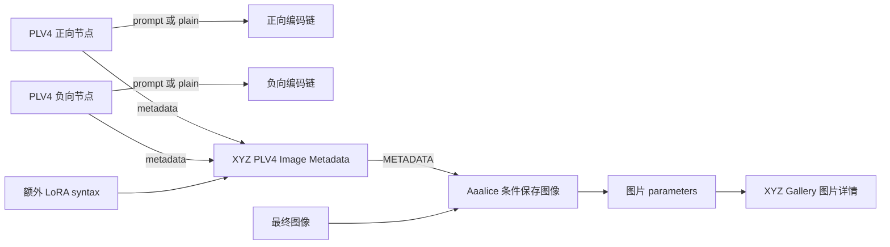

# PLV4 与 XYZ Gallery 联动：第一阶段设计

日期：2026-10-12。状态：第一阶段已在本机源码实现；隔离 PNG 保存与 Gallery/Region 主路径已观察通过，正式加载需要重启 ComfyUI 和 Ctrl+F5。实现与验证边界见 `prompt_library_v4/DEVELOPMENT.md` 的同日 metadata 节。

## 目标与已确认方向

图片详情能够查看、复制生成时的 PLV4 Source，并切换查看该节点本次运行的 prompt / plain。保留 Aaalice「💾 条件保存图像」，复用 Lora Manager 的保存与生成信息收集能力。PLV4 相关结构化数据通过 Lora Manager 的 additional_data 写入图片 parameters，不要求新增保存节点或修改 Lora Manager 的图片写入实现。

这一阶段建立「生成时文档快照 → 图片 → Gallery」链路。Gallery 阅读图片内快照，不依赖当前 Library；图片生成后修改、移动或删除 Library 资产，不改变历史图片显示。载入 PLV4、从图片保存 Block、Library 中查看关联图片属于后续阶段。

## 本机实现核对

- `prompt_library_v4/node.py` 当前返回 prompt / plain；`compiler.py` 使用同一 seed 调用共享编译器，不读取 Library。
- V4 当前 `IS_CHANGED` 排除多数文档展示信息和关闭项。新增完整文档输出后需要纳入快照变化，否则编译文字未变化时可能命中旧 metadata 缓存。
- `prompt_shared/language/compile/__init__.py` / `ir.py` 已追踪经过随机选择后的 LoRA 调用及有效时间区间。应沿用这条结果，不扫描 Source，也不为 metadata 再抽一次随机。
- Lora Manager 的 `MetadataOverwriteLM` 返回 METADATA 字典，但其自动收集器按已注册节点类型读取输入，并非保存器通用地消费任意 METADATA 字典。
- Aaalice 的 `ConditionalSaveImage` 普通 metadata 输入当前主要建立执行依赖；保存时委托 Lora Manager。它另有 `aaalice.image-generation-metadata` 分支，支持完整 parameters 覆盖。
- Lora Manager `format_metadata()` 将 additional_data 原样插入 parameters 最后一行。可以承载 PLV4 数据；Gallery 当前尚未识别此字段。
- Gallery 已有 `generation_data_json` 存储通道，但现在主要用于 NovelAI。列表和详情共用序列化入口，需要避免把完整 PLV4 Document 发给每张缩略图。

## 节点与接线



PLV4 / PLV4 Monaco 在最后追加第三个输出 `metadata`；原 prompt、plain 的插槽位置保持。建议该端口类型为 `PLV4_METADATA`，表示单节点提示词快照；合并节点最终输出才使用保存器的 `METADATA`。这样不会把尚未确定正负身份的单节点快照直接当成图片生成信息。

合并节点 `XYZ PLV4 Image Metadata`：

| 输入 | 类型 | 行为 |
|---|---|---|
| positive_metadata | PLV4_METADATA | 必需，提供正向文档和输出 |
| negative_metadata | PLV4_METADATA | 可选；不连接表示明确空负向 |
| lora_syntax | STRING | 可选，提供由其他 LoRA 加载链产生的调用语法 |
| positive_output | prompt / plain | 默认 prompt，匹配实际接入正向编码链的插槽 |
| negative_output | prompt / plain | 默认 prompt，匹配实际接入负向编码链的插槽 |

两个 output 选择用于标准 parameters 中的正负提示词；快照始终保存两种输出。metadata 分支无法证明编码链实际用了哪一个插槽，因此不能把默认值声称为自动检测结果。对编译后又修改文字、多阶段采样、多个正向 PLV4 合流的工作流，第一阶段只记录明确连接的这对节点，不猜测整个生成链。

## 单节点快照

建议 schema=`xyz.plv4.prompt-metadata`、version=1，包含：

| 字段 | 含义 |
|---|---|
| source | 执行所使用的 PLV4 Source，即有效节点投影；保留原空白和语法 |
| document | 独立的 Document v2 深拷贝，保留稳定 ID、关闭项、Block 配置和来源引用 |
| prompt | 本次 execute 返回的 prompt，原样保存 |
| plain | 本次 execute 返回的 plain，原样保存 |
| prompt_loras / plain_loras | 两种编译输出各自的有效 LoRA 记录 |
| seed | 本节点实际输入的随机种子，以十进制字符串存储，避免浏览器 64 位整数精度丢失 |
| region_mode | 本次编译使用的 couple / mask |
| compiler_policy | plv4，区分兼容 V3 的历史随机策略 |

Source 仍有随机配置与未选中的候选；关闭项只存在 document 中。因此 Source、Document、编译结果具有不同用途，不能相互替代。失效草稿照现有执行规则报错，不能输出上一版有效文档的 metadata。

编译器应暴露其已经形成的 LoRA 结果，包含调用顺序、原始 token、model/clip strength 和有效 Schedule 区间。分别跟随 prompt / plain 编译路径，避免空间展开或验证差异造成错误对应。保持现有编译文字与随机结果不变。

## 正负合并与 LoRA 规则

图片 schema=`xyz.plv4.image-metadata`、version=1。包含 positive / negative 快照、各分支 selected_output、extra_lora_syntax，以及最终 loras。METADATA 传输包另提供保存适配所需的覆盖字段 prompt、negative_prompt、loras、additional_data；编码只覆盖图片快照部分，不包含 additional_data 自身，避免递归嵌套。

1. 正负身份仅由合并节点的输入端确定，PLV4 节点不新增 polarity 设置。
2. 最终 LoRA 来源为选定正向输出的有效 LoRA，加上 lora_syntax。不采纳负向分支 LoRA。
3. 负向快照中的 source、document、prompt、plain 原样保留；只排除其 LoRA 对最终汇总的贡献，不改实际编码链，也不删原始文档的文字。图片级 negative 快照不另输出 LoRA 汇总字段。
4. 保留顺序、model/clip 两种强度与 Schedule。不能按名称去重、相加强度或让额外输入无条件覆盖正向调用。
5. 同一个完整调用、相同区间在正向与额外来源重复时，一对一去掉跨来源重复；各输入内部的显式重复保留。不同强度或区间保留为不同记录。
6. 额外 syntax 沿用共享语法解析，保留原始输入。第一阶段不为它引入随机配置或独立编译种子；非法 syntax 明确报错。
7. 汇总描述这些输入所声明的 LoRA 调用。若实际加载链被绕过或工作流另有加载器，不声称已自动核验最终模型 patch。

标准 Lora Manager LoRA 文本只作为外部工具兼容表示。其现有 formatter 对双强度和 Schedule 的解析有限；Gallery 的结构化记录才是完整表示，不能从该兼容文本反推或覆盖精确记录。

## additional_data 传输与保存适配

第一阶段建议 additional_data 使用单个明确命名的字段：

```text
XYZ PLV4: v1.<base64url 编码的 UTF-8 紧凑 JSON>
```

编码是为了让多行 Source、中文、逗号、引号和类似 `Seed:` 的正文不会干扰 parameters 的键值解析；不是加密。解码后仍是上述版本化结构。第一阶段只承诺 PNG → XYZ Gallery 的闭环；JPEG / WebP 的 EXIF 读取要单独实现与验收，不能因保存器支持这些格式就声称 Gallery 也能读。

Aaalice 增加对 `xyz.plv4.image-metadata` 的识别。使用本次保存实例的适配器，复制 Lora Manager 收集到的生成字段，再覆盖该数据包明确负责的正负 prompt、LoRA 和 additional_data，调用现有 format_metadata。模型、采样 seed、steps、CFG、sampler、尺寸等继续使用原收集结果；PLV4 节点 seed 只留在各自快照，不覆盖采样 seed。

必须按字段是否存在覆盖，而非 truthy 判断：空负向、空正向、空 LoRA 都是明确结果，不能又被自动推断值填回来。保留其他 additional_data 内容，替换同名 XYZ PLV4 项而非重复追加。适配局限在当前保存实例，不能 monkeypatch 全局类或往执行全局注册表塞临时 overwrite。

文件名变量解析需要使用同一合并视图，避免图片里的 prompt 与 `%pprompt%` / `%nprompt%` 名称不一致。已有完整 parameters 转移、普通 Lora Manager metadata 与开关关闭的行为保持；recipe 的一致性另行核对，不把新的完整快照当成已有 recipe 格式。

无需修改 Lora Manager 的保存实现。若暂时不改 Aaalice，也可以让 XYZ 合并逻辑输出四个 STRING，经现有 Metadata Overwrite 的 positive/negative/loras/additional_data 输入建立过渡链路；这可以保存 Source，但保留了中间 Overwrite 节点，不作为最终推荐接线。

保存器的 add_loras_to_prompt 可能把兼容 LoRA 文本再次加在 prompt 后面；结构化快照始终保存原输出。适配时应避免重复追加已有调用，不能让 Gallery 用被附加后的 parameters 文本覆盖快照里的精确 prompt。

## Gallery 展示与读取

检测到有效 PLV4 数据时，Positive / Negative 区各提供 `Source / Prompt / Plain`，默认 Source，复制按钮复制当前内容。保留空白、多行与 Source 原文，支持只读语法高亮；可共用既有 PLV3 语法定义，不另造 grammar，也不接入可编辑 NodeSessions 或触发 Library 写入。

LoRA 区优先显示图片包中的最终汇总，支持 model/clip strength 和 Schedule；没有 PLV4 数据的旧图继续从现有正向文本提取。PLV4 节点 seed / region mode 作为提示词信息显示，与图片的采样 seed 分开。

读取过程：

1. 从 parameters 最后一行识别唯一 XYZ PLV4 字段，按长度和结构边界解码、校验 schema/version。
2. 不以 Source 中相似文本为字段，不执行其中任何内容，不读取 Library 来补全快照。
3. 独立读取旧 workflow / parameters 的采样信息；有效 PLV4 包按字段覆盖提示词和 LoRA 展示。不能被当前「workflow 优先，parameters 仅兜底」的整包分支跳过。
4. 损坏/未知版本 PLV4 数据不阻断看图，保留普通生成信息与可诊断错误；不展示推断为真的 Source。
5. 建议将 PLV4 数据放进 generation_data_json 的命名空间字段，例如 generation.plv4。保留 NovelAI provider/characters，不能相互覆盖；若同时存在，作为两种来源展示，不把原始生成与后续编辑混成一条记录。
6. 完整 Document 只由详情 API 提供；列表 API 至多暴露 has_plv4 等摘要，不给每张缩略图携带 Source/Document。图片读取和索引按既有指纹短路与 WriteQueue 运行。

已索引图片即使生成字段完整，也可能缺新解析数据；现有“重读缺失 metadata”条件未必会选中它们。提供针对 PLV4 解析版本的定向重读方式，明确触发，不自动全库重扫、不改原图。过去没有保存 Source 的图片无法保证恢复原始文档；可讨论 workflow 回溯，但不得以重编译结果冒充当时输出。

additional_data 位于 parameters 中，因此 Gallery 的“排除生成信息”下载模式自然移除 PLV4 数据；“排除 workflow”则保留它。收藏/标签镜像写入应保留 parameters 原值。

## region mode 移入 PLV4 窗口

该设置仍决定 Region 使用 COUPLE 还是 AND/MASK；不含 Region 时差别通常不体现。默认已经是 couple。

推荐将控件移到 PLV4 窗口的节点级编译设置，默认 couple，另提供 mask。它不属于单个 Block 或 Library 资产的设置；切换节点时显示该节点自己的值，Preview 与 execute 使用同一配置。

为保持旧 workflow 的 widget 序列和 API 兼容，第一阶段隐藏 V4 的现有 region_mode widget，仍将其作为唯一序列化值，窗口修改该值。不要直接删除 shared node_schema 的输入，也不要再在 Document 中维护另一份 mode。旧 mask workflow 保持 mask；V3 兼容节点维持原输入/策略。已有 region_mode 上游连线时窗口显示外部控制状态，不静默断线或用 couple 覆盖。

## 实施顺序与验收

1. 共享编译器暴露有效 LoRA 记录；V4 追加快照输出，调整 metadata 缓存身份，保持旧两个输出插槽。
2. 实现合并节点、版本化数据包及 additional_data 编解码；复用原共享解析器。
3. Aaalice 条件保存增加数据包适配，复用本次 Lora Manager 保存实例及自动生成信息。
4. Gallery 解析、索引/详情字段与只读三种视图，区分列表摘要和完整详情。
5. V4 region_mode 控件移入窗口，保留现有序列化与旧工作流值。

实际验收观察应包含：含 Region/Schedule/AVG 的正负文档；关闭项；固定 seed 下随机 LoRA 的选择；额外 LoRA 与正向重复/不同权重；负向 LoRA 被排除；空负向/空 LoRA 不被自动补回；中文/换行/逗号/引号；保存开关关闭；embed_workflow 关闭仍可看 Source；Gallery 标签/收藏镜像与两种下载模式；旧图显示；旧 mask workflow 的窗口/Preview/execute 一致。

遵守当前项目已记录的“不新增和扩跑测试”约束：实施时先做语法/diff 与有限隔离实际链路观察，不擅自增加 suite 或广泛回归。验收文件与工作流仅放隔离目录，保持个人 Library、正式工作流及持久 8190 不被改写。

实施已覆盖上述节点/保存/Gallery/Region 主路径。未新增或扩跑测试套件；使用独立 ComfyUI、合成图像和临时浏览器观察实际链路，无模型采样或个人数据操作，正式服务和持久8190未重启。recipe/多阶段/Subgraph/Nodes 2.0 全链与 JPEG/WebP Gallery 仍在已记录验证边界内。
